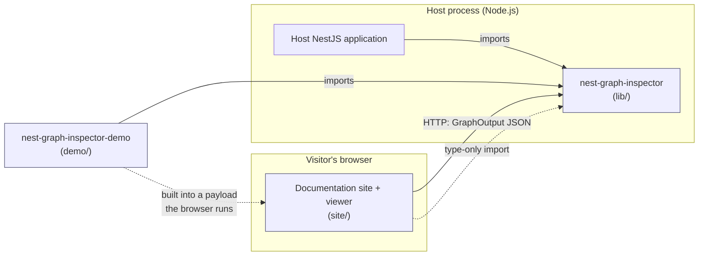
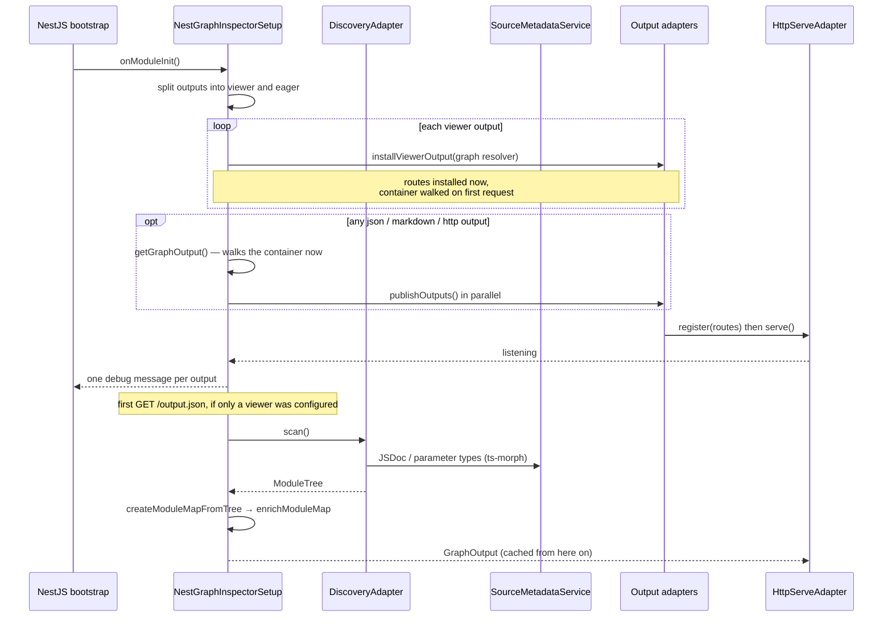
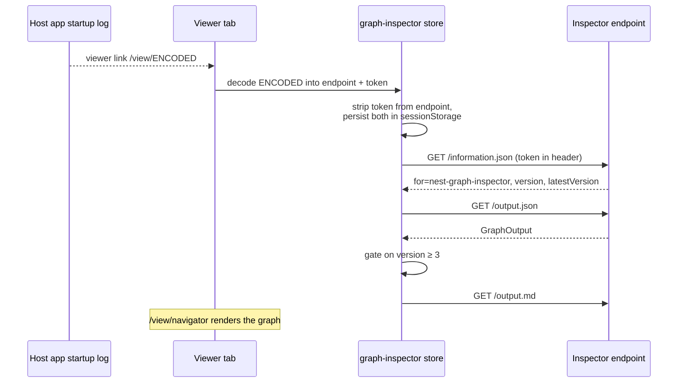

# Architecture — Nest Graph Inspector

**Read this before changing anything.** It maps how the three packages fit
together, which surfaces are contracts, and which defaults are deliberate.
Where this document and the code disagree, the code wins and the document is
the bug — fix it in the same pull request.

Narrower companion documents:

| Document | Scope |
|---|---|
| [`public-api.md`](./public-api.md) | Every symbol exported from `lib/src/index.ts` |
| [`graph-contract.md`](./graph-contract.md) | The `GraphOutput` JSON shape, field by field |
| [`development-guidelines.md`](./development-guidelines.md) | Where a change belongs, how to test it |
| [`maintainers-guide.md`](./maintainers-guide.md) | Directory-by-directory ownership |
| [`technical-debt-report.md`](./technical-debt-report.md) | Known debt, prioritised |

---

## The system in one paragraph

Once imported into a host application, Nest Graph Inspector reads the live
dependency-injection container NestJS already built, turns it into a
framework-agnostic JSON document called `GraphOutput`, and hands it to one or
more output adapters: a file on disk, a Markdown report, an HTTP endpoint
inside the host process, or the hosted interactive viewer. The viewer is a
separate Nuxt application that knows nothing about NestJS — it fetches
`GraphOutput` over HTTP and renders it. The whole design turns on that one
seam. The same document can also be produced without running the application
at all: the package's `nest-graph-inspector export` command boots it in Nest's
preview mode, where the container is built but nothing in it is instantiated,
and walks that container with the same code.

---

## Repository layout

```
nest-graph-inspector/        ← monorepo root (pnpm workspace)
├── lib/                     ← the published npm package — this is the product
│   └── src/
│       ├── adapters/        ← output channels and container discovery
│       ├── cli/             ← the `nest-graph-inspector export` command
│       ├── ports/           ← the interfaces adapters implement
│       └── types/           ← public types + the JSON Schema
├── demo/                    ← private NestJS app: development host and showcase
│   ├── src/                 ← an ordinary NestJS application
│   ├── scripts/             ← packages that application for the browser
│   ├── test/                ← e2e tests, including network-level security tests
│   └── docs/                ← legacy demo documentation
├── site/                    ← Nuxt 4 documentation site + interactive viewer
│   ├── app/                 ← Nuxt app directory (pages, stores, components)
│   ├── content/             ← MDC documentation pages
│   ├── server/              ← Nitro routes and the docs MCP server
│   ├── scripts/             ← payload verification
│   └── public/nodepod-demo/ ← generated demo payload (gitignored)
├── docs/                    ← repository-level design docs (this file)
└── .github/workflows/       ← CI, publish, deploy
```

Workspace members ([`pnpm-workspace.yaml`](../pnpm-workspace.yaml)): `demo`,
`lib`, `site`. The root `package.json` is private and holds no source; its
scripts fan out across the workspace, and their ordering is not cosmetic — see
[Build, test, release](#build-test-release).

---

## The three packages and the direction of dependency



Three rules follow, each enforceable by reading a `package.json`:

1. **`lib/` depends on nothing in this repository.** Its only runtime
   dependency is `ts-morph`; `@nestjs/common` and `@nestjs/core` are peers. It
   must never gain a frontend dependency.
2. **`site/` depends on `lib/` for types only.** `site/package.json` lists
   `"nest-graph-inspector": "workspace:*"`, and the site imports only from the
   public entry point — `import type { GraphOutput } from
   'nest-graph-inspector'` — never an internal source path. At runtime it holds
   no NestJS code; it speaks HTTP.
3. **`demo/` is not the library.** It consumes the package as a user would,
   through its built entry points. Production logic does not belong here.

Both `demo/` and `site/` resolve `nest-graph-inspector` through `lib/dist`,
which does not exist in a fresh checkout — so CI and every root script build
the library before anything type-aware runs against them (see
[Build, test, release](#build-test-release)).

---

## The contracts that span packages

Changing one side of any of these alone breaks the other.

### 1. The public API — `lib/src/index.ts`

Everything re-exported there is public: adding is a feature, changing or
removing is breaking. It currently exports the module and its options types,
the default ignore constants (`DEFAULT_IGNORE_OPTIONS`, `DEFAULT_IGNORE_PATHS`)
so an application can extend the default rather than replace it, the graph
output types and JSON Schema, the graph layout types, JSON Schema
and `validateGraphLayout`, the Direct Run and runtime-trace types,
and the access-token/rate-limiter surface (`AccessTokenService`,
`AccessAttemptLimiter`, and their constants) so an application can mint its own
tokens. Keep [`public-api.md`](./public-api.md) in step.

Several classes — `NestGraphInspectorSetup`, `GraphOutputBuilder`,
`RuntimeTraceRecorder`, the adapters, the port interfaces, the CLI's modules —
are reachable by deep import but are *not* in `index.ts`. They are internal;
treat a deep import in user code as unsupported.

The package has a command line too: `lib/package.json`'s `bin` maps
`nest-graph-inspector` to `dist/cli/bin.js`. Its command, options, exit codes,
and output file are public in the same sense as `index.ts` — CI scripts and
the demo's own build call it — and are documented in
[`public-api.md`](./public-api.md#command-line--nest-graph-inspector).

### 2. The graph output JSON — `GraphOutput`

Produced by `lib/` — served at `/output.json`, written by the `json` output,
and written by `nest-graph-inspector export` — and consumed by the viewer in
`site/`. It is versioned:

| Constant | Location | Value |
|---|---|---|
| `GRAPH_OUTPUT_SCHEMA_VERSION` | `lib/src/types/graph-output.schema.ts` | `'3'` |
| `MINIMUM_SUPPORTED_GRAPH_OUTPUT_VERSION` | `site/app/utils/graph-output-support.ts` | `3` |

A breaking change to the shape must bump the library constant, update
`GRAPH_OUTPUT_JSON_SCHEMA` (including its `$id`, which carries the version),
raise the viewer's minimum, and update
[`graph-contract.md`](./graph-contract.md) — in one pull request. Rather than
render a graph whose version it does not support, the viewer shows an "update
your package" modal, so a half-done bump is visible to users immediately.

### 3. The graph layout JSON — `GraphLayout`

Where the viewer has placed a graph's modules and items, saved to a file in
the host application's working tree so an arrangement survives restarts and
can be committed. Unlike `GraphOutput` it flows both ways: the viewer reads it
from `GET {path}/layout.json` and writes it back with `POST {path}/layout`.

| Constant | Location | Value |
|---|---|---|
| `GRAPH_LAYOUT_SCHEMA_VERSION` | `lib/src/types/graph-layout.schema.ts` | `'1'` |
| `GRAPH_LAYOUT_SCHEMA_ID` | `lib/src/types/graph-layout.schema.ts` | `…/schemas/graph-layout-v1.schema.json` |

The library validates every layout it accepts or serves with
`validateGraphLayout`, and `additionalProperties` is `false` throughout. The
direction matters here: the hosted viewer is always the latest release while
the library is whatever version the application installed, so a viewer must
send an older library only the fields its layout version defines — a new
field is a version bump, not something an older library quietly drops. Field
by field, the shape is in [`public-api.md`](./public-api.md#graph-layout-types).

---

## `lib/` — the published package

### Ports and adapters

The library is ports and adapters, thinly applied. One port:

- `OutputAdapter<Config>` (`lib/src/ports/output.adapter.ts`) —
  `execute(graphOutput, config): Promise<{ message: string }>`, implemented by
  every output channel. `NestGraphInspectorSetup` logs the returned `message`
  at `debug` level.

Not everything under `adapters/` is an output adapter — the directory name is
looser than the port. `DiscoveryAdapter` reads the container, `HttpServeAdapter`
is the HTTP server itself, and `DirectRunOutputAdapter` builds routes rather
than implementing the port.

### Component inventory

| Component | File | Role |
|---|---|---|
| `NestGraphInspectorModule` | `nest-graph-inspector.module.ts` | `@Module` entry point; owns `defaultOptions` and the default ignore constants; exports `AccessTokenService` |
| `ConfigurableModuleClass` | `nest-graph-inspector.config.ts` | Nest's `ConfigurableModuleBuilder`, giving `forRoot` / `forRootAsync` |
| `NestGraphInspectorSetup` | `nest-graph-inspector.setup.ts` | `OnModuleInit`; dispatches the graph to the configured outputs; extends `GraphOutputBuilder` |
| `GraphOutputBuilder` | `graph-output.builder.ts` | Turns the `ModuleTree` into `GraphOutput`: dependency references, Direct Run metadata, cycles. The running inspector and the CLI export both build with it |
| `DiscoveryAdapter` | `adapters/discovery.ts` | Walks `ModulesContainer` into a `ModuleTree`; instruments providers for tracing |
| `SourceMetadataService` | `source-metadata.service.ts` | ts-morph project; JSDoc and parameter-type lookup by class name |
| `RuntimeTraceRecorder` | `runtime-trace.recorder.ts` | Records call spans via `AsyncLocalStorage` |
| `AccessTokenService` | `access-token.service.ts` | Mints, verifies, and guards with HMAC-signed tokens |
| `AccessAttemptLimiter` | `access-attempt-limiter.ts` | Per-client lockout for repeated invalid tokens |
| `HttpServeAdapter` | `adapters/http-serve.adapter.ts` | Standalone `node:http` server and router; no Express/Fastify |
| `HttpOutputAdapter` | `adapters/http-output.adapter.ts` | Registers the graph and layout routes; owns the host/port and layout-file defaults; reads and writes the layout file |
| `ViewerOutputAdapter` | `adapters/viewer-output.adapter.ts` | Composes HTTP + Direct Run; prints the viewer link |
| `FileOutputAdapter` | `adapters/file-output.adapter.ts` | Writes the Markdown report (Mermaid + prose) |
| `JsonOutputAdapter` | `adapters/json-output.adapter.ts` | Writes raw `GraphOutput` JSON |
| `DirectRunOutputAdapter` | `adapters/direct-run-output.adapter.ts` | Builds the routes that invoke provider and controller methods |
| `createInspectorEndpointInfo` | `inspector-endpoint-info.ts` | Builds the `information.json` handshake payload |
| The export CLI | `cli/` | `nest-graph-inspector export`: boots the application in Nest's preview mode and writes its `GraphOutput`; see [the export CLI](#the-export-cli--nest-graph-inspector-export) |

Intermediate types under `types/` — `ModuleMap`, `Modules`, `ModuleProvider`,
`ModuleController` — are the *pre-enrichment* representation. They are not the
contract; `GraphOutput` is.

### Startup sequence



**Viewer outputs are lazy; every other output is eager.** The viewer installs
its endpoints at bootstrap but resolves the graph on the first request — that is
what `GraphOutputSource` (a value *or* a resolver) in `http-output.adapter.ts`
is for: a host application should not pay to walk the container and run ts-morph
over the sources at startup if nobody ever opens the viewer. Add a `json`,
`markdown`, or `http` output and the container *is* walked at bootstrap,
because those adapters need a graph to write. Either way the result is cached
in a field and built once per process.

**Outputs are dispatched in parallel.** `publishOutputs` is a `Promise.all` over
the eager outputs, and the viewer installs run as their own `Promise.all` before
them. No output may depend on another having run.

**A failing output never fails the application.** Both `publishSingleOutput`
and `installViewerOutput` catch, log an error, and return: an inspector that
cannot bind its port must not stop a host application from starting. So a
broken output is a log line, not a crash, and easy to miss.

### Discovery and enrichment

`DiscoveryAdapter.scan()` produces a `ModuleTree`, and
`GraphOutputBuilder.enrichModuleMap()` — which `NestGraphInspectorSetup`
inherits — turns it into `GraphOutput`:

1. **Find the root.** Either `options.rootModule`, or inferred by locating the
   module that imported the inspector.
2. **Walk the tree.** Imports, exports, providers, and controllers per module,
   with the `ignore` option applied — by name, injection token, route path, or
   source file path, and an ignored module takes everything reached only
   through it along. Ignored providers and controllers are also left
   uninstrumented for runtime tracing. The default `ignore` is
   `{ paths: ['**/node_modules/**'] }` — `DEFAULT_IGNORE_OPTIONS`, built from
   `DEFAULT_IGNORE_PATHS` — so source files are looked up unless `paths` is
   configured empty. A class's source file is whichever file in the
   `SourceMetadataService` project declares a class of that name, and that
   project never holds files under `node_modules` (ts-morph leaves
   dependencies resolved there out of `getSourceFiles()`). Classes from
   installed packages therefore have no file to match, and the default
   pattern hides them only if the host's own project places a declaring file
   under `node_modules`. `InternalCoreModule`, `ModuleRef`, and
   `ApplicationConfig` are no longer hidden by default.
   The inspector's own module is the one exception `ignore` cannot undo:
   `DiscoveryAdapter` skips any module whose class is
   `NestGraphInspectorModule`, along with its providers and any re-export of
   it, because tracing the inspector's own `RuntimeTraceRecorder` recurses
   into itself and would crash bootstrap, and its adapters would otherwise
   become Direct Run targets.
3. **Fold in NestJS core.** Providers named in `nestCoreProviders`
   (`ModuleRef`, `ApplicationConfig`, `Reflector`, `REQUEST`, `INQUIRER`) are
   collected under one virtual module named by `nestCoreModuleName`
   (`NestJSCoreModule`), so the graph does not sprout framework internals in
   every real module.
4. **Resolve dependencies.** Constructor parameters *and* property-injected
   `@Inject()` members resolve from injection tokens to a
   `GraphOutputDependencyRef` carrying `token` plus the `providedBy` module.
   A provider is named, and matched to a token, by its class, its factory
   function, or its token — never by the instance a `useFactory` or
   `useExisting` provider holds, which preview mode does not have; see
   [provider names](./graph-contract.md#provider-names).
5. **Enrich from source.** `SourceMetadataService` opens the application's own
   `.ts` files with ts-morph to attach JSDoc to modules, providers, and
   controllers, and to render Direct Run parameter types as TypeScript source
   text. Best-effort: no sources found means no JSDoc, not a failure.
6. **Detect cycles.** Three separate passes — modules, providers, controllers —
   each classified `direct` or `indirect`, with a canonical key so the same
   cycle is not reported once per rotation. Provider cycles carry a richer path
   (`{ module, provider }` items) than module and controller cycles (plain
   name strings); that asymmetry is real and known
   ([TD-10](./technical-debt-report.md)).

### Output adapters and the route table

`defaultOptions` configures a single `viewer` output on
`HttpOutputAdapter.defaultConfig` — **host `0.0.0.0`, port `53371`**.

| Output | Config | Effect |
|---|---|---|
| `json` | `{ path }` | Writes `GraphOutput` as JSON, relative to `process.cwd()` |
| `markdown` | `{ path }` | Writes a Mermaid diagram plus a per-module report, and an `information.json` beside it |
| `http` | `{ origin?, host?, port?, path? }` | Registers the graph and layout routes; default path `/__nest-graph-inspector` |
| `viewer` | `{ origin?, host?, port?, path?, directRun? }` | `http` + Direct Run (unless `directRun.enabled: false`) + prints the viewer link; default path `/__graph-inspector` |

Layout persistence is a module-wide setting, `NestGraphInspectorModuleOptions.ui.layout.saveAs`
(`'file' | 'runtime'`, default `'file'`), attached by `NestGraphInspectorSetup`
to every `viewer` and `http` output. `'file'` saves to a fixed path, `./.muse`
relative to `process.cwd()` — not configurable, and not per-output, so every
`viewer` and `http` output on the default shares one file. `'runtime'` keeps
the layout purely in memory on `HttpOutputAdapter`, never touching disk; it
resets to an empty layout on every restart.

Everything a `viewer` output installs, on one server:

| Method | Path (relative to the output's `path`) | Serves |
|---|---|---|
| `GET` | `/information.json` | Handshake: `for`, `is-static`, `version`, `latestVersion`, `isLatestVersion` |
| `GET` | `/output.json` | `GraphOutput` |
| `GET` | `/output.schema.json` | `GRAPH_OUTPUT_JSON_SCHEMA` |
| `GET` | `/output.md` | The Markdown report |
| `GET` | `/layout.json`, `/layout` | The saved `GraphLayout`, or `{ version: '1', modules: {} }` when no file exists yet |
| `POST` | `/layout`, `/layout.json` | Validates the body as a `GraphLayout` and replaces the layout file with it |
| `POST` | `/direct-run` | Invokes `{ module, target?, provider?, controller?, method, args }` |
| `GET` | `/direct-run/histories` | Every completed `RuntimeTrace` |
| `GET` | `/direct-run/history/index.json` | Trace summaries |
| `GET` | `/direct-run/history/*` | One trace by id |

`information.json` is the handshake the viewer probes with: the site treats a
response whose `for` is `nest-graph-inspector` as proof it has found an
inspector. Its `is-static` flag says which kind of source answered — the
`markdown` output writes the same payload beside its file with
`is-static: true`, so a graph read from disk is distinguishable from one served
by a running application, letting the viewer hide what only a live process can
do.

`latestVersion` comes from an npm registry lookup bounded to **2 seconds**
(`LATEST_VERSION_TIMEOUT_MS`) and memoised per process. Unbounded, it would
hold up the host application's own startup on a network that blackholes rather
than refuses — and that awaited `fetch` is also what keeps the in-browser
demo's event loop alive long enough to boot.

**The layout routes are the only ones that write to disk on request.** The
file they write is fixed by configuration, never named by the request, and the
body is bounded (10 MiB, `MAX_LAYOUT_BODY_BYTES`, `413` beyond it) and must pass
`validateGraphLayout` before anything is written, so a caller holding the
token can change what the file says but not where it goes or what kind of
document it is. Saves to one file run one at a time in arrival order — two
overlapping `writeFile` calls on one path can interleave into invalid JSON — and
a read waits for a save in progress. A file that exists but cannot be read back
as a layout answers `500` with the reason rather than an empty layout, so a
broken file (a merge conflict in a committed layout, say) is surfaced instead of
silently replaced by the next save.

`HttpServeAdapter` keys routes by `"METHOD path"` and supports `*` for either
half plus trailing-`/*` prefixes. Several outputs may register against the same
origin; the server is created once and started once.

### Security architecture

The inspector serves the shape of an application's internals from inside that
application, and Direct Run invokes real provider and controller methods on
request. The
defaults below are deliberate: when you touch `http-serve.adapter.ts` or
`direct-run-output.adapter.ts`, question them rather than treating them as
inherited noise.

**Access tokens are on by default.** `AccessTokenService.createHttpGuard()` is
attached to every route the inspector registers — graph and Direct Run alike.

| Property | Value |
|---|---|
| Format | `ngi1.<base64url payload>.<HMAC-SHA256 signature>` |
| TTL | 3 hours (`DEFAULT_ACCESS_TOKEN_TTL_MS`) |
| Secret | `accessToken.secret`, else `NEST_GRAPH_INSPECTOR_TOKEN_SECRET`, else a random per-process secret |
| Minimum safe secret | 32 characters — a short one is recoverable offline from a single leaked token |
| Transports | `Authorization: Bearer`, `x-graph-inspector-token`, `?__inspector_token=` |
| Comparison | Constant-time (`timingSafeEqual`) |

The token rides in the printed viewer link, so the hosted viewer carries it
into every follow-up request without anyone copying it by hand — which leaves a
live credential in the startup log. Hence `accessToken.logToken: false`, for
environments that ship logs somewhere the token should not reach; turning it
off means supplying your own `secret` and minting tokens yourself, and the
printed link is then deliberately incomplete.

**Brute force is capped, not merely rejected.** `AccessAttemptLimiter` keys on
the socket's remote address — never a forwarded header, which a caller can set:

| Default | Value |
|---|---|
| `maxFailures` | 10 per window |
| `windowMs` | 60 000 ms |
| `blockMs` | 15 minutes, answered `429` with `Retry-After` |
| `maxTrackedClients` | 1 000, so the tracker cannot itself be grown without limit |

Only a genuine *guess* counts: a request with no token, or with a real token
that has expired, is not counted. Behind a reverse proxy every request arrives
with the proxy's address, so one attacker can lock everyone out for `blockMs`;
lower it or disable the limiter in that topology.

**The library forwards nothing.** It used to install a proxy on the viewer
output that took a caller-supplied body and sent it to a local Ollama daemon,
hardened against being turned into an open relay. The AI chat now runs the model
in the visitor's browser, so that endpoint — and the request-forwarding surface
it carried — is gone rather than defended.

**Two things are wide open on purpose.** The viewer's CORS policy allows every
origin (`origins: [/.*/]`), and the default bind interface is `0.0.0.0`. The
viewer is hosted on GitHub Pages while the inspector runs on the developer's
machine, so a same-origin policy would make the product impossible; the token
guard, not the origin check, is what makes that safe. Preflight is answered
without a token by design — a browser sends no credentials on a preflight —
which `demo/test/graph-inspector-security.e2e-spec.ts` asserts explicitly,
along with the lockout behaviour, over real TCP.

### Direct Run and runtime tracing

Direct Run turns the viewer into something that *does* things rather than only
showing them: a `POST /direct-run` with `{ module, target, provider |
controller, method, args }` looks the target instance — a provider or a
controller — up in the live container and calls a method on it. `target` is
`"provider"` or `"controller"` — it defaults to `"provider"` when absent, so a
request built before this field existed still resolves exactly as it did — and
the request names the target only through the field matching it (`provider`
or `controller`), never both, so a request can never be ambiguous about which
instance table it addresses. Which methods are callable depends on
`directRun.allowUnsafeMethods`, which governs both target types:

- **Permissive (default, `true`).** On a provider, any callable method found
  on the instance or its prototype chain may be invoked, including ones
  TypeScript marks `private` or `protected` — that keyword is erased at
  compile time and is not a runtime boundary. Only `constructor` is refused
  outright, because invoking it as a plain method call is not a provider
  "method" in any sense a caller intends. A controller gets a narrower rule,
  described below. This favors local development ergonomics: the default
  assumes Direct Run is reached by a trusted developer, not exposed to the
  open internet.
- **Strict (`false`).** Only the exact public prototype method advertised for
  that module/provider or module/controller in its `directRun` metadata may be
  invoked, and only when it is not shadowed on the instance. Constructors,
  Nest lifecycle hooks, inherited methods, instance-shadowed methods, and
  TypeScript-`private` or `-protected` methods are refused. Since
  `private`/`protected` are erased at compile time and such a method is an
  ordinary callable prototype member at runtime, that exclusion is the one
  check `SourceMetadataService` — not the
  runtime shape of the object — has to make, by reading the method's
  modifiers from the application's own sources; a method whose source cannot
  be found, or whose class name resolves ambiguously across the application's
  sources, is not treated as public. The graph's `directRun` metadata only
  ever advertises methods confirmed public this way, regardless of which mode
  is active, so the metadata itself never grows to include unsafe methods.

**Controllers are a Direct Run target too**, resolved from their own instance
table — never the provider one, and never the reverse — so a same-named
provider and controller in one module can't be confused for each other; a
name that doesn't exist in the target's own table is a `404`, not a fallback
lookup in the other. A controller's advertised methods follow the same
eligibility rules as a provider's, plus an optional `http: { method, path }`
read from NestJS's own route metadata when the method is a routed handler —
informational only, since Direct Run never sends this method an HTTP request
and never runs its guards, interceptors, pipes, or parameter decorators. The
path is the first `@Controller()` prefix joined with the method's first path;
it does not include a `RouterModule` mount path, the global prefix
(`app.setGlobalPrefix`), URI versioning, or any prefix but the first, so it
can differ from the URL the application actually serves.

Controller permissive mode is stricter than provider permissive mode by
design, since there is no existing DX contract to preserve for a brand-new
invocation surface. Only a *direct* controller method resolves: a
function-valued own property of the instance or — when the instance has no own
property of that name — a method declared on the controller's own class, its
immediate prototype. Both are read through property descriptors, so a getter
is refused without ever running. The constructor, Nest lifecycle hooks,
accessors, and every inherited method — whether from a base class or from a
built-in prototype such as `Object.prototype` — are refused with `400`.
TypeScript-`private` methods declared on the controller's own class stay
callable, exactly as on a provider. See
[`docs/controller-direct-run-design.md`](./controller-direct-run-design.md)
for the full design.

`directRun.enabled` defaults to `true`; setting it to `false` omits all
Direct Run and trace-history routes. Both `allowUnsafeMethods` and
`maxBodySizeBytes` (below) can be set module-wide via
`NestGraphInspectorModuleOptions.directRun`, or per `viewer` output via that
output's own `directRun`, which wins when both are set.

Direct Run reads at most `directRun.maxBodySizeBytes` of encoded request
bytes, **50 MiB by default**; `0` or a negative number removes the limit.
Oversized payloads receive a generic `413` response, and UTF-8 is decoded
across chunk boundaries before JSON is parsed.

Around that call `RuntimeTraceRecorder` builds a trace. `DiscoveryAdapter`
instruments provider and controller prototypes once (tracked in a `WeakSet`,
so wrapping is never doubled) while preserving each method's arity, and each
instrumented method opens a span. `discovery.ts` refuses to instrument
prototypes shared by every object of their kind — the `BUILTIN_PROTOTYPES` set
in `direct-run.constants.ts`: `Object.prototype`, `Array.prototype`,
`Function.prototype`, `Map.prototype`, `Promise.prototype`, and the rest of the
built-ins — before any `defineProperty` call reaches them, because wrapping a
method found there would patch it for the entire process, not just the
instance being instrumented; an instance whose immediate prototype is one of
these (a plain object literal, an array, a bare function) is left
uninstrumented rather than corrupting a shared prototype. Controller Direct
Run reads the same set, which is why it lives beside the Direct Run constants
rather than in `discovery.ts`.
Two `AsyncLocalStorage` stores — one for the active trace, one for the span
stack — give the nesting, so a call graph several providers deep is
reconstructed without explicit plumbing. A method returning a promise gets its
span settled when the promise settles; a span whose promise nobody awaited is
marked rather than lost, which is why `RuntimeTraceStatus` has a `partial`
state alongside `success` and `error`. At most 100 completed traces are
retained in memory; the oldest insertion is evicted first. Traces are written
to disk too when a `json` output is configured — `viewer-output.adapter.ts`
derives the history directory from that output's path and rewrites its index
from current memory.

A trace records each span's module, class, and method, but not whether that
class is a provider or a controller. The viewer's trace page
therefore re-runs a span only as a provider, and offers to only when the graph
knows the span's class as a provider of that module and not also as a
controller there. It never offers to re-run a controller span: re-sent as a
provider, that would be refused with a `404` — or, when the module also has a
provider of the same name, run that provider's method instead.

### The export CLI — `nest-graph-inspector export`

A running inspector reads the container its host application built while
starting. `nest-graph-inspector export` builds that container without starting
anything, in Nest's own preview mode
([CI/CD integration](https://docs.nestjs.com/devtools/ci-cd-integration)), and
writes the `GraphOutput` a running inspector would serve. The user-facing
documentation, limitations included, is
`site/content/1.getting-started/5.export-graph.md`.

**What preview mode guarantees**, as read in `@nestjs/core` 11 rather than taken
on trust:

- `Injector.instantiateClass` returns before calling a constructor or a factory
  when `preview` is set and the provider's module is not `initOnPreview`.
  Dependencies are still resolved first, so a missing provider fails an export
  exactly as it fails the application. A class provider or controller keeps the
  prototype-only instance `InstanceLoader.createPrototypes` made for it, a
  `useValue` provider keeps its value, and a `useFactory` or `useExisting`
  provider has no instance at all.
- `getModulesToTriggerHooksOn()` keeps only `initOnPreview` modules in preview
  mode, so `init()` — which `createApplicationContext()` calls — and `close()`
  run no hook anywhere else. `initOnPreview` comes from
  `InitializeOnPreviewAllowlist`, which Nest itself fills with
  `InternalCoreModule` alone.
- `listen()` refuses to run in preview mode. The export calls neither it nor
  `NestApplication.init()`, which is what calls a module's `configure()`.

```
1. Parse argv with node:util parseArgs; --help and --version load neither
   Nest nor TypeScript
2. Delegate: when the project resolves its own nest-graph-inspector, and that
   copy is not this one and ships the bin, spawn it with the same argv
   (NEST_GRAPH_INSPECTOR_CLI_DELEGATED stops a second hop); a copy without the
   bin gets a warning, and the export carries on
3. Load --env-file files into process.env with process.loadEnvFile(), last
   to first, so that — as with node --env-file — the environment wins and a
   later file beats an earlier one. The export never loads main.ts, which is
   where an application usually loads its environment before AppModule
4. Find the entry: --entry, or from nest-cli.json's sourceRoot and the outDir
   of the tsconfig `nest build` compiles with — <outDir>/app.module.js,
   <outDir>/<sourceRoot>/app.module.js, or the only app.module.js under
   <outDir>. Never main.js, which would start the application
5. chdir to the project, so .env files and tsconfig.json resolve as they do
   when the application starts there
6. Divert process.stdout to stderr for the rest of the process, then load the
   --require modules, the project's own reflect-metadata and @nestjs/core, and
   the entry — import() when Node treats it as an ES module (.mjs, or .js
   under "type": "module"), require() otherwise — and pick the root module
   export
7. Boot: NestFactory.create(root, { preview: true, snapshot: true,
   abortOnError: false, logger }), or createApplicationContext() when
   @nestjs/platform-express does not resolve from @nestjs/core
8. Read the options: the MODULE_OPTIONS_TOKEN value NestGraphInspectorModule
   registered, through forRoot() or a plain import. forRootAsync() registers a
   factory preview mode never runs: defaults, the entry module as root, and a
   warning. A NestGraphInspectorModule from another copy: the same, with that
   module ignored by name. No inspector at all: defaults, the entry as root
9. Build: GraphOutputBuilder over a DiscoveryAdapter subclass that skips
   runtime-trace instrumentation, with a fresh SourceMetadataService
10. close() the application, write the JSON, print a summary to stderr, and
   exit explicitly, since a module file may have left a handle open
```

Why each step is the way it is:

- **Nest from the project, never from beside the CLI.** Under `npx` the CLI can
  live in a temporary directory holding its own copy of the peers. A second
  `@nestjs/core` would build a second, empty container, and the application's
  classes are decorated against the project's `reflect-metadata`. Both are
  loaded through `createRequire(<project>/package.json)` before the entry, and
  the library's graph code only after them. That code still resolves its own
  `@nestjs/common` and `@nestjs/core` from wherever the package is installed —
  for decorators and constants, never to boot anything — and once the
  project's own copy runs the export, those are the project's too. Nothing the
  CLI loads before delegating needs a Nest package beside it, so delegation
  works from a copy installed without its peers.
- **Delegation.** `DiscoveryAdapter` recognises the inspector's module by class
  identity (`metatype === NestGraphInspectorModule`), and the options by
  `MODULE_OPTIONS_TOKEN`, which `ConfigurableModuleBuilder` generates afresh in
  every copy of the package. Only the copy the application imports can match
  them.
- **`abortOnError: false`.** Otherwise Nest answers a failed bootstrap with
  `process.abort()`; with it, the error is thrown, and the CLI reports it and
  exits `1`.
- **The platform check.** `NestFactory.create()` without
  `@nestjs/platform-express` logs an error and calls `process.exit(1)` from
  inside Nest. An application context builds the same container without any
  HTTP platform — nothing that differs between the two is part of the graph —
  so a standalone or Fastify-only application is booted that way.
- **Standard output.** `--out -` must carry the graph and nothing else, so
  from the moment the application's code can first run until the process
  exits, `process.stdout.write` sends it to stderr — `console.log`, Nest's
  logger, and a timer the application set that fires after the export
  included. The graph, the CLI's messages, and the final flush go through the
  streams' own `write`, captured before any application code ran, so neither a
  late write nor a replaced `process.stderr.write` can corrupt or stall them.
  A write straight to file descriptor 1 is beyond this.
- **Load order.** `nest-graph-inspector.module` imports
  `nest-graph-inspector.setup`, which extends `GraphOutputBuilder`, which
  imports `adapters/discovery`, which imports the module back. That cycle
  resolves only when the module file loads first, as it does through the
  package entry, so `cli/export-graph.ts` imports it before anything else from
  the package — and the CLI loads that file only after the project's own Nest.

**Where an export differs from a running inspector's graph** is where a
running inspector reads a provider's *instance*, which preview mode never
creates: the Direct Run methods of `useFactory` and `useExisting` providers,
read off the value a factory returned or the provider an alias points at.
Nothing else in the graph reads an instance — a factory provider is named by
its factory function or its token, and matched to dependencies by its token,
never by the class of what it returned (see
[provider names](./graph-contract.md#provider-names)) — so
`cli/export-graph.spec.ts` pins that one difference down against a live
`/output.json` and finds everything else byte-identical. That includes global
enhancers: Nest rewrites an `APP_GUARD`, `APP_INTERCEPTOR`, `APP_PIPE` or
`APP_FILTER` token to `APP_GUARD (UUID: …)`, random on every start and a hash
under the export's `snapshot: true`, and the graph names it without the UUID,
so it is the same on every start and in an export; several for one token in a
module share the name. Modules and providers
added once the application runs — through `LazyModuleLoader`, for instance —
exist only in a running application.

**What checks it.** `cli/export-graph.spec.ts` boots a fixture application
(`cli/__fixtures__/`) in which every constructor, factory, lifecycle hook, and
`configure()` records itself, and requires an export to record nothing, listen
on nothing, and still produce every module, provider, controller, route, and
cycle; it then compares the export with the `/output.json` the same application
serves when booted normally. `cli/bin.spec.ts` compiles the package into a
temporary project, as npm would install it, and runs the bin there with `node`:
entry detection, standard output, ES module entries, delegation, a project copy
too old for the CLI, and failures. `demo/test/graph-export.e2e-spec.ts` requires
the demo's export to equal the running demo's `/output.json` byte for byte.

---

## `demo/` — development host and showcase

`demo/src` is an ordinary NestJS application with four feature modules — User,
Product, Order, Mobile — and an inspector running all four output types at once
(viewer on `localhost:53371`, a second plain `http` output on
`localhost:53372/graph`, Markdown and JSON into `demo/tmp/graph/`).

Its module graph is deliberately awkward, because a graph tool needs something
worth graphing:

- **A module-level cycle**: `OrderModule` ⇄ `UserModule` via `forwardRef`.
- **A provider-level cycle**: `OrderService` ⇄ `OrderNotificationService`,
  resolved with `forwardRef` inside `@Inject()`.
- **A second cycle through Mobile**: `ProductModule` ⇄ `MobileModule`.
- **A useless import**: `ProductModule` imports `UserModule` and uses nothing
  from it, on purpose, to check the inspector reports it.
- **A third-party module**: `ConfigModule.forRoot()` inside `MobileModule`, so
  the graph contains something the repository does not own.

**A known false positive.** For the demo, the Issues page reports
`ConfigService` as registered in 2 modules. `ConfigModule` registers a
`ConfigService` provider whose factory returns `ConfigHostModule`'s instance,
so there is one instance, not two, but the graph does not say that a factory
hands back another module's instance. The static `graph.json` and the demo run
by Node show it; the in-browser demo, which keeps to `src/`, does not. Teaching
the duplicate check about such factories is a follow-up.

`demo/test/` holds three e2e suites: an application-level one exercising the
demo's own REST routes *and* then reading the token-gated graph endpoint over
TCP; the network-level security suite described above, which boots the real
module and probes it over real sockets; and the export suite, which requires
`nest-graph-inspector export` of the demo's `nest build` output — and of its
TypeScript sources, through `ts-node` — to equal the `/output.json` the running
demo serves, byte for byte.

**None runs by default.** They live behind `pnpm --filter
nest-graph-inspector-demo run test:e2e` with their own Jest config, while the
demo's plain `test` script is scoped to `src/` and passes with no tests. Root
`pnpm run test` — and therefore CI — does not reach them. Change anything in
the security surface and you must run `test:e2e` yourself; nothing else will.
They run in band: the application-level and export suites both boot the
demo's `AppModule`, whose inspector binds fixed ports.

The application knows nothing about the documentation site, deliberately: it is
a NestJS project you could copy elsewhere and run unchanged. Everything the
browser needs differently lives in the payload build.

---

## `site/` — documentation and viewer

A Nuxt 4 application deployed to GitHub Pages under the base path
`/nest-graph-inspector/`. It carries four surfaces.

### 1. The documentation site

MDC pages under `site/content/`, rendered by `@nuxt/content` through
`app/pages/[...slug].vue`, with numeric directory prefixes driving navigation
order. Beyond the pages:

- `server/routes/raw/[...slug].md.get.ts` serves any doc page back as raw
  Markdown, for tools and for LLM consumption.
- `server/mcp/tools/` exposes `list-pages` and `get-page` as an MCP server
  (`@nuxtjs/mcp-toolkit`), so an agent can read the documentation directly.
- `nuxt-llms` generates `llms.txt` from the same collections.
- `app/components/content/*.vue` are the live previews embedded in prose — they
  are not screenshots; they run the demo.

### 2. The interactive viewer



**A viewer URL names a view, not a graph** — the part of the routing model
most easily got wrong. `/view/<encoded>` carries a bootstrap link once, on
arrival; `resolveViewerBootstrap` decodes it, and the tab keeps the endpoint
and token in `sessionStorage` under `nest-graph-inspector:session` — session
rather than local storage deliberately, so the credential is scoped to one tab
instead of shared across every tab in the browser.

The token never goes back into a URL: it lives in the Pinia store and leaves
only as the `x-graph-inspector-token` header, added by a `$fetch` instance that
reads it per request. `probeEndpoint` — used by the `/view` landing card to guess
at a local inspector — pointedly does *not* use that authenticated fetch, so
probing a host never hands it a live credential for another one.

The viewer pages are `navigator` (the Vue Flow graph), `issues` (architecture
health: cycles, duplicate providers, unused imports, dead exports, and
disconnected modules), and `trace` (Direct Run traces as a waterfall of timed,
nested spans, drawn by `TraceWaterfall.vue`). `trace` was called
`execution-sequence` until it was renamed; `RENAMED_VIEWER_PAGES` in
`viewer-bootstrap-link.ts` keeps the old name working, so the bootstrap
middleware redirects `/view/execution-sequence` to `/view/trace` and an old
printed link ending in `/execution-sequence` lands there too. Everything on
`issues` except the cycles is derived in the viewer by
`app/utils/architecture-issues.ts` from fields the graph already carries, so
it needs no change to `GraphOutput` and works against any library version the
viewer supports. A module's deep dive lives under the navigator at
`/view/navigator/modules/<id>`, where `<id>` is the module name through
`encodeModuleId` (`app/utils/module-id.ts`); it is the one viewer URL deeper
than `/view/<page>`, so the bootstrap middleware matches it explicitly, and it
draws the module alone, laid out by `app/utils/module-deep-dive.ts` from fields
the graph already carries (horizontally on desktop, or vertically on mobile
viewports with dependencies at the top and dependents below). `nuxt.config.ts` renders `/view/**` client-side only —
neither the tab's session nor the developer's local endpoint exists on a server
— while `/view` itself keeps SSR so it still unfurls as a link.

**The graph file source.** The viewer has a second kind of graph besides an
endpoint: a `GraphOutput` file — what `nest-graph-inspector export` writes, the
`json` output, or a saved `/output.json`. The `/view` landing card opens one
from **Open Graph File** or a drop anywhere on the page, and the viewer
header's File menu opens one in place of whatever graph is on screen (**Open
Graph File…** on an endpoint, the in-browser demo's included; **Open
Another…** on a file) — one that fails leaves that graph where it is and sends
the visitor to `/view?autoload=false`, where the drop zone says why;
`useGraphFileOpener` (`app/composables/`) reads it with `File.text()` and
`app/utils/graph-file.ts` checks it — a 20 MB cap before reading, JSON syntax,
every field the viewer reads down to each dependency, and the format version
against `MINIMUM_SUPPORTED_GRAPH_OUTPUT_VERSION`. Older is refused with a
message naming the field or the version; newer than
`NEWEST_KNOWN_GRAPH_OUTPUT_VERSION` opens with a notice, as an endpoint's
newer graph renders. The graph store's `openGraphFile` then forgets the
endpoint, its token and its session, and holds the graph as `fileSource` +
`fileGraph`; `graphData` is the file's graph or the fetched one, never both.
Nothing is uploaded, nothing is fetched or probed on the file's behalf, and the
demo is not booted. A file is static: Direct Run says why it cannot run (and
offers no trace, which a file has none of), the trace page says the same, the
layout is kept for the tab under the file's `kind:name` and can be downloaded,
the header has no reload beside its File menu, which offers Close Graph as
well, and the AI chat looks things up in the graph and nothing else — its
excerpt mode reads `/output.md`, which only the library writes, and the site
will not rebuild the library's Markdown, so on a file the panel's mode toggle
stays on its lookup mode and says why (see the AI chat, below). The demo's static graph
opens the same way, as the `example` kind, for `/view?preview=true` when no
demo is running. For a reload the tab keeps the graph in `sessionStorage`
(`nest-graph-inspector:graph-file`, `graph-file-session.ts`) when it is at most
1.5 million characters of compact JSON; a larger one keeps only its name, and a
reload lands on `/view` asking for that file again. The bootstrap middleware
and `useGraphViewerPage` restore a file through `restoreGraphSource` and pass
it straight through — no token check, no demo session, no fetch — except the
demo's static graph once the visitor has started the demo in the tab, which the
running demo takes the place of (see the in-browser demo, below).

**Analytics never carry the graph.** The site's own events name a viewer route
by its shape (`describeViewerRoute`) and a graph file only by its kind
(`graph_source`: `file` or `example`, on the `graph_viewer_load_*` events, plus
`graph_file_opened` and `graph_file_rejected` with the problem's kind) — never
its name or contents. PostHog's own properties are handled by
`plugins/posthog-privacy.client.ts`, whose `before_send`
(`app/utils/analytics-privacy.ts`) rewrites every viewer route in every event —
`$current_url`, `$pathname`, session and person URLs, heatmap keys — to that
shape and drops the page title on viewer pages, since a deep dive's path names
a module and the navigator's query can name one too. The viewer layout marks
itself and the body `ph-no-capture`, which keeps PostHog's click capture and
session replay off everything it draws, teleported drawers and popovers
included; so does the `/view` file drop zone. The one part of a viewer page
outside the body is its `<title>`, so no viewer page names the graph there —
the deep dive is "Module Deep Dive" — and `session_recording.maskTextSelector`
in `nuxt.config.ts` masks titles in replays besides.

Rendering stack: Vue Flow for the graph, Mermaid for sequence diagrams, Monaco
for JSON editing, ApexCharts for timings, and LangChain over `@mlc-ai/web-llm`
for the AI chat panel.

**The graph carries the application's own documentation.** Every module,
provider and controller in `GraphOutput` may hold a `jsdoc` string —
`SourceMetadataService` reads it from the sources with ts-morph — and
`GraphViewer.vue` shows it in a hover card when the pointer rests on a module
title or an item node. The library extracts a class's *description* only, so
block tags such as `@param` never reach the viewer; `jsdoc-preview.ts` parses
what does arrive into paragraphs and bullet lists, and a node with nothing
documented opens no card and carries no dotted underline. The card is placed by
`hover-card-position.ts` against the viewer's own box rather than the window's,
because the viewer hides its overflow. It is on by default; "Show JSDoc on
hover" in the graph settings panel turns it off.

### 3. The in-browser demo

Every demo the site runs — the previews on the landing page once the visitor
presses "Load Example", and the demo `/view` opens when the visitor asks for it
— is the `demo/` application actually running, on
the [nodepod](https://www.npmjs.com/package/@scelar/nodepod) browser-native
Node.js runtime, in the visitor's own tab. Until then the previews draw the
demo's static graph, exported from the same build (see the boot sequence
below). Nothing a running demo shows is captured ahead of time:
Direct Run really invokes provider and controller methods, runtime traces
really accumulate, and the JSDoc and parameter types in the graph come from
the sources of the application that is answering.

**The payload.** `demo/scripts/build-nodepod-payload.ts` writes these files
into `site/public/nodepod-demo/`:

| File | What it is |
|---|---|
| `main.js` | The demo application bundled into one CommonJS file (~13.9 MB, ~2.2 MB gzipped); the NestJS runtime packages (`@nestjs/common`, `@nestjs/core`, `@nestjs/platform-express`, `rxjs`, `reflect-metadata`) are left external and supplied by the vendor snapshot |
| `sources.json` | The demo's `.ts` sources plus a flattened `tsconfig.json`, so the library's ts-morph source reader still finds JSDoc and Direct Run parameter types |
| `manifest.json` | Revision, working directory, entry file, and the environment the application is started with |
| `vendor-snapshot.json.gz` | The NestJS runtime packages exactly as installed — source maps, type definitions and all, so an error inside the pod can be traced to its cause — as a prebuilt virtual `node_modules` (~3.05 MB gzipped), copied from `site/assets/nodepod-demo/` and restored into the pod instead of being installed; required by the build, which fails without it, and always listed in `manifest.json` |

`graph.json` lands beside them, but is not part of the payload: the demo's
`build:nodepod` script runs the built CLI as its last step (`export:graph`,
`nest-graph-inspector export --compact`), after the payload build has emptied
the directory, and writes the demo's graph there — byte for byte what the demo
serves at `/output.json` when Node runs it (`graph-export.e2e-spec.ts` holds
the two together), without anything having been booted. `manifest.json` does
not list it. The site does read it: `useExampleGraphStore`
(`app/stores/example-graph.ts`) fetches it for the landing page's previews and
for `/view?preview=true`, so every site build has to publish it, and
`test:demo-payload` checks that it is there, that the viewer opens it, and that
it holds every module the payload serves. It holds more than that: the payload
build patches the bundled discovery adapter so the in-browser demo shows only
what is declared under the demo's own `src/` (`DISCOVERY_PATCHES` in
`demo/scripts/build-nodepod-payload.ts`), while `export:graph` runs the
library as it is published. The static graph therefore also has
`ConfigModule`, `ConfigHostModule` and `NestJSCoreModule`, and the providers
they declare — the third-party module the demo imports on purpose — and the
landing previews show them until "Load Example" swaps in the live graph. Generated with the payload and gitignored
with it, it cannot go stale. `build:graph` regenerates it alone.

**Two constraints shape this design.**

1. **Decorator metadata forces a tsc-then-bundle pipeline.** Nest resolves
   constructor dependencies from `emitDecoratorMetadata` output, and TypeScript
   is the only compiler in this repository that emits it. So the payload is
   built from the `nest build` output (`demo/dist/src/main.js`); esbuild only
   stitches the emitted JavaScript into a single file. Bundling the TypeScript
   directly would produce an application whose providers cannot be injected.
   Nest's optional peers (`@nestjs/microservices`, `@nestjs/websockets`,
   `class-validator`, `class-transformer`) stay external, so a missing feature
   fails where it would fail on a real machine.
2. **The service-worker scope rule forces a fetch bridge.** nodepod would
   rather serve its virtual HTTP servers through a service worker, but it
   registers that worker with scope `/`, and GitHub Pages serves the site from
   `/nest-graph-inspector/` and cannot answer with `Service-Worker-Allowed`.
   The pod is therefore booted headless, and requests to the demo's servers are
   addressed under `<site base>/__nodepod__/<port>/…` and answered in the tab by
   a `fetch` bridge that calls `pod.request(port, …)`.
   `site/app/utils/nodepod-demo-endpoint.ts` owns that address space and is
   covered by `nodepod-demo-endpoint.test.ts`.

**What checks it.** `pnpm --filter nest-graph-inspector-site run
test:demo-payload` (`site/scripts/verify-nodepod-payload.ts`) boots the built
payload on the same runtime — headless, on `worker_threads` instead of Web
Workers — spawns it, and reads the graph endpoint out of the startup log with
the site's own parser. It is the only thing exercising the two couplings this
design rests on: that the bundle starts at all, and that the viewer link the
library prints is still in a shape the site can read. Every workflow that
generates the site runs it right after building the payload.

**Boot sequence.**

```
1. The visitor asks for it: "Load Example" on the landing page's hero or
   Direct Run preview, or on the /view landing card. Nothing else starts it —
   not the landing page (/) opening, and not /view or the pages under it on
   arrival (see below)
2. nodepod-demo store downloads manifest.json, main.js, sources.json, and the
   vendor snapshot
3. Nodepod.boot({ workdir, env, headless: true }) boots a pod with no files;
   the vendor snapshot is restored into it, which replaces the pod's whole
   volume, and only then are main.js and the sources written into the workdir
4. The fetch bridge is installed for <site base>/__nodepod__/<port>/…
5. pod.spawn('node', ['main.js']) → the NestJS application starts
6. The store reads the printed viewer link out of the application's own startup
   log and treats it as the bootstrap credential it is: the endpoint keeps its
   path, rewritten onto the bridged address; the access token comes out of the
   URL and goes to the graph store, which sends it as a header from then on
7. /view puts both in the tab's session and opens /view/navigator, which loads
   the graph through the same HTTP contract as any other endpoint — as does
   any viewer page the visitor reaches while it runs (see below)
```

Nothing starts the demo on its own. The landing page (`/`) opens on the demo's
**static graph**: `site/public/nodepod-demo/graph.json`, which the demo's
`build:nodepod` (and `build:graph`) script exports with `nest-graph-inspector
export` from the same build the payload is made of, and the site publishes
beside the payload — the one file under `nodepod-demo/` the site fetches on its
own. Every preview draws it, fetched once per document, relative to the site's
base URL (`useExampleGraphStore`, `app/stores/example-graph.ts`), and checked
like any graph file a visitor opens. Opening `/` downloads nothing else from
`nodepod-demo/` — no `manifest.json`, `main.js`, `sources.json` or vendor
snapshot — and boots nothing; the caption says the graph is static, exported
with `nest-graph-inspector export` from the demo project. A missing
`graph.json` is an inline error in each preview, with "Load Example" still
offered.

"Load Example" — on the hero preview, the Direct Run preview, and the `/view`
landing card — is the only thing that runs the demo, and it boots it exactly as
step 2 onwards describes. Once it is running, every preview on the page draws
the live graph instead (`useNodepodDemoGraph`, `app/composables/`; the
decision itself is `resolveDemoPreviewView` in
`app/utils/demo-graph-preview.ts`), and the Direct Run preview runs methods
against it; until then its drawer says Direct Run needs the example loaded. A
demo already running in the tab — started from `/view` — is drawn live as soon
as a preview mounts: reading its graph boots nothing. The viewer keeps the same
rule the other way round, below: once started, the demo is what `/view` and
every viewer page show, whichever page started it.
Measured on a local static build in Chromium before the landing page stopped
starting it: pod boot and snapshot restore take ~1.0 s, the runtime is ready to
spawn ~2.2 s after navigation, and the live graph arrives at ~11.6 s, most of
it the NestJS application starting from `main.js`. Only the mount fetches
anything — never server rendering — so the page's text renders and stays
readable while a preview shows a skeleton; a demo that failed in the tab is
started again only when the visitor retries, from the preview's inline error or
the dialog. `/view` never starts the demo on arrival: it opens on the landing
card — Learn Why, Install It, Load Example, and the Open Graph File drop zone —
and its local-inspector polling, and starts the demo when the visitor clicks
"Load Example" — behind a loading card with a Cancel that stops the pod and
falls back to the landing card. Four things move on without a click, decided
by `resolveViewerLandingAction` (`app/utils/viewer-landing.ts`):
`?preview=true` — a preview's "Open full-screen demo" link — joins the demo that
preview is already running or starting in the tab and opens the viewer on it,
and with no demo to join opens the static graph as a graph file (see "The graph
file source", above) rather than booting one; a demo this document is running
or starting is joined whenever the tab is on no graph, on the demo's static
graph, or on a demo session (`liveDemoTakesOver`,
`app/utils/live-demo-takeover.ts`); a tab on a graph file goes back to
`/view/navigator`; and a tab whose session names the visitor's own
application, with a token the viewer would accept, goes straight back to
`/view/navigator` (`/view/trace` with `?trace=true` or
`?execution-sequence=true`). `?autoload=false` holds back all but the first —
the viewer's "Try Another URL" and the file menu's Close Graph link there. A
restored demo session with no demo behind it — a reload, a restored tab — is
never redirected. `/view` always hands off with a history replace, so Back from
the viewer does not return to a page that would only send the visitor forward
again. One pod then serves every preview on the page and the viewer, so the
payload is downloaded and the application booted once for as long as it keeps
running. A failure opens one dialog, wherever it was started from, saying what
went wrong in the store's own words — the application's output is never shown;
the retry it offers boots another one.

**Once started, the demo is never dropped by navigation.** "Load Example" on
a preview starts the pod and nothing else: it leaves the tab's graph-viewer
session where it was — on no graph, or on the static graph "Open full-screen
demo" opened — so the viewer settles the matter as the visitor arrives, by one
rule (`liveDemoTakesOver`): for as long as the document lives, the running
demo takes the place of no graph, of the demo's static graph, and of a demo
session, and never of what the visitor chose — a graph file they opened, or
their own application's session — unless they ask for the demo outright: a
preview's "Open full-screen demo" (`/view?preview=true`) joins it over any
graph, theirs included. `/view` joins it, as above. The bootstrap middleware
applies the same rule to the viewer's own pages, carrying out what
`resolveViewerPageArrival` (`app/utils/viewer-page-arrival.ts`, over
`resolveViewerPageTakeover`) decides: arriving at one — through a header tab,
or Back to a page that showed the static graph — with the demo running puts
it in the tab's session with the graph store's `setDemoSession`, the call
`/view` makes, so the demo is drawn the same way whichever way the visitor
reached it, and the page loads it like any endpoint; with the demo still
starting, a tab on no graph or the static graph is sent to `/view`, which
waits for it behind its progress. A demo session is the page's own to settle,
running or starting, through `use-nodepod-demo-session.ts`: it is put on the
running pod's credential, or waits on the page for a start in flight. A
navigation that only changes a page's query or hash keeps the graph the page
shows, which it loaded as it mounted. Neither ever starts the demo, so before
"Load Example" nothing changes: `/` draws the static graph, `/view` waits on
the landing card, and `?preview=true` opens the static graph. Only the
visitor's own choice puts anything else on screen: a graph file they open —
from the landing card, or from the File menu in every viewer page's header,
over the demo as over anything else (`resolveViewerGraphControls` in
`app/utils/viewer-header.ts`) — their own application's printed link, or Close
Graph and Try Another URL, which go to `/view?autoload=false`; and a reload,
which ends the pod. A file opened over the demo takes the tab, which the rule
above then leaves alone, while the demo keeps running in the background for the
landing page's previews and for "Load Example" to rejoin. The File menu stays
in place but out of use only while a demo session waits for the demo to start
again: its endpoint is let go meanwhile, and the start puts the demo back in
the session when it is up.

A reload restores the endpoint from the tab's session (a viewer page names a
view, not a graph) — and for the demo that endpoint is answerable only by the
tab that started it. `use-nodepod-demo-session.ts` recognises such an endpoint
and never starts the demo to answer it: it forgets the session and sends the
visitor to the `/view` landing card, where "Load Example" boots a fresh demo
with a fresh token. A demo still running or starting in the tab is reused instead. A
token the endpoint has begun refusing — the demo's expires on the library's own
schedule, and a tab left open outlives it — is handled the same way, except
that the application behind it is still running, so it is stopped as well:
"Load Example" would otherwise join it and hand back the credential that was
just refused.

**What the payload build accommodates.** The bundle is prepended with a few
lines the application never sees, because the browser runtime differs from Node
in two ways it would otherwise fall over on:

- **Two `Buffer` implementations that do not recognise each other.**
  `require('buffer').Buffer` is not the global one, and each one's `isBuffer`
  rejects what the other made. Express builds a response body with one and
  hands it to `etag`, which checks with the other, so every response from the
  demo's own REST routes is a 500. The shim makes recognition symmetric and
  changes nothing about what is created.
- **A process ends when its event loop looks empty.** Neither a virtual HTTP
  server nor an in-flight cross-origin `fetch` holds it open, and the inspector
  awaits one during startup — the npm lookup behind `latestVersion` in
  `information.json` — so without a timer the application exits underneath its
  own bootstrap, before it ever prints a viewer link.

Both belong to the runtime, not to the application, which is why they live in
the build rather than in `demo/src`. `site/scripts/verify-nodepod-payload.ts`
calls one of the demo's own routes for exactly this reason: it is what fails
first when an accommodation stops working.

Known limitations, accepted deliberately:

- `SharedArrayBuffer` is unavailable without COOP/COEP headers, so nodepod
  falls back to full per-spawn snapshots.
- The payload is a few megabytes, downloaded once per visit that presses "Load
  Example". The static graph the landing page draws until then is about 8 KB.
- The pod lives as long as the page: nothing tears it down on a route change,
  and the keep-alive timer means it never idles out either.
- If the application stops after the graph has loaded, the viewer keeps showing
  that graph while every new request to it fails, and nothing on screen says
  why: the application's output is never shown.

### 4. The AI chat, which runs entirely in the browser

The assistant has no server side. `@mlc-ai/web-llm` downloads model weights from
HuggingFace into the browser's Cache API and runs inference on the visitor's GPU
through WebGPU, inside a web worker. The library's only contribution is the graph
it already serves: the Markdown at `/output.md`, which the plain path budgets
down to fit the model's context window and uses as the system prompt, and the
`GraphOutput` JSON, which agent mode's tools query (below). The
graph, the question, and the answer never leave the machine, and nothing has to
be installed for the feature to work — at the cost of requiring a WebGPU-capable
browser on a desktop, in a window at least `MOBILE_BREAKPOINT_PX` wide
(`app/utils/device-detection.ts`), which the viewer checks for before offering
the chat. What kind of device a tab is on comes from `@nuxtjs/device`
(`useDevice()`), which classifies the user agent; `useMobileDevice` adds the two
things a user agent cannot say — an iPad on iPadOS 13 or later, which reports a
Mac's user agent and is told apart by its touchscreen, and the window's width,
followed as it changes.

**The chat talks to a LangChain model, not to web-llm.** The panel never calls
`@mlc-ai/web-llm`. It builds a `ChatWebLlm` — a LangChain `BaseChatModel`
wrapping the engine — and talks to that. The indirection buys one thing, and it
is the reason it exists: which model answers is a constructor argument. Putting
`@langchain/openai`, `@langchain/anthropic` or a later web-llm release behind the
same panel is a swap of one object, not a rewrite of the chat. In-browser
inference is the right default for a tool that discusses the developer's own
application, but it should not be the only thing this panel can ever do.

The seam is `WebLlmStreamer` in `app/utils/web-llm-boundary.ts`: two functions,
`streamChat` and `interrupt`. `useWebLlmEngine` fills them from web-llm and
`ChatWebLlm` reads them, and neither knows anything else about the other — which
is also what makes the chat model, and the entire agent loop above it, testable
in a plain node script against a scripted engine, with no browser, no GPU and no
downloaded weights.

**Tool calling is implemented on our side rather than delegated.** web-llm has
its own function-calling path, but it refuses any model outside a five-entry list
of Hermes builds — and reading what it does once it accepts one shows the list is
a bet, not a capability: it interpolates the tool schemas into a system prompt,
constrains the reply with a JSON grammar, and parses the result back. `ChatWebLlm`
does both of those directly, so tools bind to **every** model in the catalog,
including the recommended 2 GB one. Constrained decoding is the stronger half of
that: a fine-tune makes well-formed output likely, a grammar at the sampler makes
it certain. What neither fixes is judgement — a 1.7B model still picks the wrong
tool sometimes — which is what the catalog's `toolCallingQuality` is for, and it
is a sentence the panel shows, never a condition it branches on.

**Agent mode exists because the context window is 4096 tokens.** The plain path
puts an excerpt of the graph Markdown in the prompt, and on a real application
that excerpt is most of the window and still not most of the graph. The agent
inverts it: almost no graph in the prompt, and six read-only tools the model
queries for the part the question needs. It is the better answer for a large
graph and the worse one for a small one, so the panel defaults by graph size and
lets the reader switch — except on a graph file, which is the JSON and nothing
else: the Markdown the plain path reads is the library's to write, and the site
does not rebuild it. So the header opens the chat on a file as on an endpoint
(`resolveAiChatAvailability`, with the same device restriction), the panel
answers it in agent mode alone and fetches nothing for it, and the mode toggle
stays on and says why (`resolveAiChatAnswerMode`, `app/utils/ai-chat-mode.ts`).

This replaced an HTTP proxy inside the library that forwarded chat requests from
the viewer origin to a local Ollama daemon. Deleting it removed a
request-forwarding relay from the library's attack surface: an endpoint installed
in the host application whose whole job was to take a caller-supplied body and
send it somewhere else. A feature that needs no server component should not ship
one, and the boundary the site consumes is now exactly the graph contract and
nothing more.

---

## Build, test, release

Root scripts fan out across the workspace, and the ordering inside them is
load-bearing:

| Script | What it does |
|---|---|
| `verify` | build library → lint → typecheck → test → build. **Run this before opening a PR.** |
| `build` | library, then the demo payload and the demo's exported `graph.json` |
| `build:site` | library, demo payload and graph, then the Nuxt build |
| `dev` | library, payload and graph, then demo and site in parallel |
| `test` / `lint` / `typecheck` | recursive, `--if-present` |

The library must be built first every time
([why](#the-three-packages-and-the-direction-of-dependency)).

Test runners differ per package, on purpose: `lib/` uses Jest with specs beside
the code (`*.spec.ts`) — `cli/bin.spec.ts` among them compiles the package into
a temporary project and runs its bin with `node`, so the CLI is tested as
installed rather than through `lib/dist`, which can be stale and, in the
library matrix job that tests before it builds, is absent; `site/` uses `node --test` with
`--experimental-strip-types` over `app/**/*.test.ts`, no framework. The demo's
e2e suites sit outside all of it under `test:e2e`, so the library's own specs
are what CI actually gates the security behaviour on.

Workflows:

| Workflow | Trigger | What it gates |
|---|---|---|
| `ci.yml` | PR, push to `main` | `verify` job; library on Node 20/22/24; a full site build including the payload boot check |
| `deploy-site.yml` | GitHub release published | Re-runs lint/typecheck/test, stamps the version from the release tag, publishes to npm with provenance, then builds and deploys the site to Pages |
| `publish-test-package.yml` | manual | Publishes a prerelease under the `test` dist-tag |
| `redeploy-site-on-tag.yml` | manual | Rebuilds and redeploys the site from any ref |

**The version in `lib/package.json` is a placeholder** (`0.0.1-development-only`)
on `main`. The real version is stamped from the release tag at publish time, so
never treat that field as meaningful in the repository.

Commits follow Conventional Commits with scopes `lib`, `demo`, `site`, `deps`.

---

## Extension points

**Adding an output type.** Four edits, in four files: implement
`OutputAdapter<Config>`; add the variant to the `NestGraphInspectorOutput` union
in `nest-graph-inspector.type.ts`; register the class in
`NestGraphInspectorModule`'s providers; inject it into `NestGraphInspectorSetup`
and add it to the `outputAdapters` record its constructor builds, which is what
maps an output's `type` to its adapter. Decide also whether the new output is
eager or lazy — `onModuleInit` treats everything that is not `viewer` as eager.
Landing in four places is known debt
([TD-06](./technical-debt-report.md)), not a pattern to imitate elsewhere.

**Adding a field to the graph.** Contract first: extend
`graph-output.type.ts` and `graph-output.schema.ts` together, deciding whether
the change is additive or breaking (if breaking, follow
[the version rules](#2-the-graph-output-json--graphoutput)). Then extraction in
`discovery.ts` / `graph-output.builder.ts`, the demo, the payload rebuild, the viewer, and
[`graph-contract.md`](./graph-contract.md).

**Adding a viewer page.** Add the route under `site/app/pages/view/`, register
its name in `VIEWER_PAGES` in `viewer-bootstrap-link.ts` so a bootstrap link
can address it, and read graph data from the `graph-inspector` store rather
than fetching directly — it owns the token.

**Adding an HTTP route to the library.** Build it with
`HttpServeAdapter.get`/`post` and register it through the same
`register({ authorize: accessTokenService.createHttpGuard() }, …)` call the
existing adapters use. A route registered without that guard is unauthenticated;
that is never the default.

---

## Invariants contributors must preserve

1. **The library has no UI dependency.** Do not import frontend packages into
   `lib/**`.
2. **The site has no NestJS runtime dependency.** It consumes graph data
   through the HTTP contract, and imports from `nest-graph-inspector` for types
   only — never an internal source path.
3. **`demo/src` is not the library.** Changes there are demo-only and must not
   alter the public API.
4. **`GraphOutput` is a versioned contract.** A breaking change bumps every
   version marker in one PR — see
   [the version rules](#2-the-graph-output-json--graphoutput).
5. **Output adapters are pluggable via `OutputAdapter<Config>`.** New output
   types implement the port.
6. **The HTTP server is framework-independent.** `HttpServeAdapter` uses plain
   `node:http` and must not gain an Express or Fastify dependency.
7. **Every inspector route is token-guarded.** Adding a route means adding the
   guard. Widening CORS, changing the bind interface, or bypassing the guard is
   a security change: add a case to
   `demo/test/graph-inspector-security.e2e-spec.ts` **and run it yourself**
   (`pnpm --filter nest-graph-inspector-demo run test:e2e`) — CI does not.
8. **The demo payload is bundled from compiled JavaScript.**
   `demo/scripts/build-nodepod-payload.ts` must keep its entry point on the
   `nest build` output; pointing the bundler at `demo/src/**` drops the
   decorator metadata Nest resolves constructor dependencies from, and the
   application fails to boot in the browser.
9. **The printed viewer link is a parsed interface.**
   `site/app/utils/nodepod-demo-endpoint.ts` reads the endpoint out of the
   startup log; change the shape of that line in `viewer-output.adapter.ts` and
   the in-browser demo stops finding its own graph — `test:demo-payload` catches
   it.
10. **`lib/` and `demo/` compile under `strict`, spec files included.** Do not
    weaken `tsconfig.base.json` to make a change compile.
11. **An export runs nothing.** `nest-graph-inspector export` boots in preview
    mode and never calls `init()` or `listen()`. `lib/src/cli/export-graph.spec.ts`
    requires that no constructor, factory, lifecycle hook, or `configure()` of
    the application runs and that nothing listens.
12. **There is one graph builder.** The running inspector and the export both
    build `GraphOutput` with `GraphOutputBuilder` over a `DiscoveryAdapter`;
    never give the export its own. `export-graph.spec.ts` and
    `demo/test/graph-export.e2e-spec.ts` compare an export with a live
    `/output.json`.
13. **A graph file goes nowhere.** The viewer reads it in the tab: no upload,
    no request made for it, no demo booted, and neither its name nor its
    contents in an analytics event. `graph-file.test.ts`,
    `graph-file-session.test.ts` and `analytics-privacy.test.ts` cover the
    pieces.
14. **The landing page boots nothing.** Its previews draw the static
    `nodepod-demo/graph.json`; only "Load Example" downloads the payload and
    starts the demo. `demo-graph-preview.test.ts` covers the decision.
15. **An export boots the project's own Nest.** The `@nestjs/core` that boots
    the application, and the `reflect-metadata` it is decorated against, load
    from the project before the entry, never from beside the CLI; and a copy of
    the package the project installed that ships the CLI runs the export
    instead.
16. **Once started, the demo is never dropped by navigation.** For the life of
    the document that ran "Load Example", `/view` and every viewer page show
    the running demo in place of no graph, the demo's static graph, or a demo
    session — never in place of a graph file the visitor opened or their own
    application, unless they ask for the demo outright with a preview's "Open
    full-screen demo" (`/view?preview=true`) — and nothing but "Load Example"
    starts it. `live-demo-takeover.test.ts` and `viewer-page-arrival.test.ts`
    cover the decision, the bootstrap middleware's included.

---

## Known deliberate risks

These are not bugs but trade-offs with a reason, listed so nobody "fixes" one
without knowing what it buys.

| Decision | Why | Cost |
|---|---|---|
| Default bind `0.0.0.0` | The viewer is hosted elsewhere and must reach the developer's machine | The endpoint is reachable from the local network; the token is what protects it |
| Wildcard CORS on the viewer output | A hosted viewer on a fixed origin cannot be same-origin with an arbitrary developer machine | Any page can *attempt* a request; none succeeds without the token |
| The token is printed in the startup log | It is the only handoff point, and copying it by hand would make the product unusable | Log shipping captures a live credential — `accessToken.logToken: false` is the escape hatch |
| Direct Run invokes real methods | The trace is only honest if the call is real | In the default permissive mode, an authenticated caller can run any callable method on a provider, and any direct method of a controller, including ones TypeScript marks `private`; set `directRun.allowUnsafeMethods: false` to restrict calls to the public methods advertised in that provider's or controller's Direct Run metadata. It remains a development tool, not a production one |
| Rate limiting keys on socket address | A forwarded header can be set by the caller | Behind a reverse proxy all callers share one bucket |
| ts-morph reads application sources | JSDoc and parameter types cannot be recovered from decorator metadata alone | Real startup cost for any eager output, deferred to the first request for a viewer-only config; degrades silently when sources are absent |
| The export loads the application's module files | Preview mode is Nest's own resolution: dynamic modules, `forwardRef`, global modules, and missing providers come out exactly as they do at runtime, which parsing the sources would only approximate | Code at the top level of those files runs — `.env` reads, `forRoot()` calls — and `--entry` pointed at `main.js` would start the application |
| The export boots with `snapshot: true` | It is the boot the CLI was specified with: `preview` together with `snapshot`, as Nest documents preview mode for graph tooling | Nest then builds each dynamic module's key with an unguarded `JSON.stringify` of its metadata, so a `forRoot()` whose options hold a circular object or a `BigInt` fails the export though the application starts; the CLI's hint says so |

---

## Where this document may drift

Facts a code change can invalidate, and the file to check:

- Schema version `'3'` — `lib/src/types/graph-output.schema.ts`
- Viewer minimum version `3` — `site/app/utils/graph-output-support.ts`
- Default host/port `0.0.0.0:53371` — `lib/src/adapters/http-output.adapter.ts`
- Default paths `/__graph-inspector` (viewer) and `/__nest-graph-inspector`
  (http) — the respective adapters
- Default ignore `{ paths: ['**/node_modules/**'] }` — `DEFAULT_IGNORE_PATHS`
  and `DEFAULT_IGNORE_OPTIONS` in `lib/src/nest-graph-inspector.module.ts`
- That the source index excludes `node_modules` — `SourceMetadataService` in
  `lib/src/source-metadata.service.ts`, and the ts-morph version it runs on
- Layout schema version `'1'` — `lib/src/types/graph-layout.schema.ts`
- Default layout file `./.muse` and the 10 MiB layout body limit —
  `DEFAULT_LAYOUT_FILE_PATH` and `MAX_LAYOUT_BODY_BYTES` in
  `lib/src/adapters/http-output.adapter.ts`
- Token TTL, header, and query parameter — `lib/src/access-token.service.ts`
- Limiter defaults — `lib/src/access-attempt-limiter.ts`
- Viewer page names — `site/app/utils/viewer-bootstrap-link.ts`
- Route table — `http-output.adapter.ts` and `viewer-output.adapter.ts`
- Which controller methods permissive Direct Run resolves —
  `resolvePermissiveControllerMethod` in `direct-run-output.adapter.ts`
- The CLI's options and defaults (`nest-graph.json`, `AppModule`, the entry
  candidates, exit codes) — `lib/src/cli/cli.ts`, `export-command.ts`, and
  `project.ts`
- That Nest's preview allowlist holds only `InternalCoreModule`, and what
  preview mode skips — `InitializeOnPreviewAllowlist` and
  `Injector.instantiateClass` in the installed `@nestjs/core`
- Where an export differs from a running inspector's graph —
  `lib/src/cli/export-graph.spec.ts`
- The demo graph's path, `site/public/nodepod-demo/graph.json` — `export:graph`
  in `demo/package.json`, and `EXAMPLE_GRAPH_FILE` in
  `site/app/utils/demo-graph-preview.ts`, which the landing page's previews
  fetch
- That the static demo graph holds more than the in-browser demo serves — the
  `src/`-only filter in `DISCOVERY_PATCHES`
  (`demo/scripts/build-nodepod-payload.ts`), which the export does not apply
- The newest graph format the viewer knows, `3` —
  `NEWEST_KNOWN_GRAPH_OUTPUT_VERSION` in `site/app/utils/graph-output-support.ts`
  (checked against the library's by `graph-output-support.test.ts`)
- The graph file limits: 20 MB to open, 1.5 million characters kept for a
  reload — `MAX_GRAPH_FILE_BYTES` in `site/app/utils/graph-file.ts` and
  `MAX_STORED_GRAPH_CHARS` in `site/app/utils/graph-file-session.ts`
- Which graphs the running demo takes the place of, and what a viewer page does
  while it is still starting — `liveDemoTakesOver` and
  `resolveViewerPageTakeover` in `site/app/utils/live-demo-takeover.ts`, and
  what the bootstrap middleware does on arriving at a viewer page —
  `resolveViewerPageArrival` in `site/app/utils/viewer-page-arrival.ts`
- That the AI chat answers a graph file in agent mode only —
  `resolveAiChatAnswerMode` in `site/app/utils/ai-chat-mode.ts`
- Which properties PostHog stamps with the page's URL, and that `ph-no-capture`
  still blocks click capture and replay — `posthog-js`, which
  `site/app/utils/analytics-privacy.ts` and `layouts/viewer.vue` rely on
- Demo bundle size `~13.9 MB`, `~2.2 MB` gzipped —
  `site/public/nodepod-demo/main.js`, written by
  `demo/scripts/build-nodepod-payload.ts`
- Vendor snapshot size `~3.05 MB` gzipped —
  `site/assets/nodepod-demo/vendor-snapshot.json.gz`, rebuilt by
  `site/scripts/build-raw-spike-snapshot.ts`; also quoted in
  `demo/scripts/build-nodepod-payload.ts`
